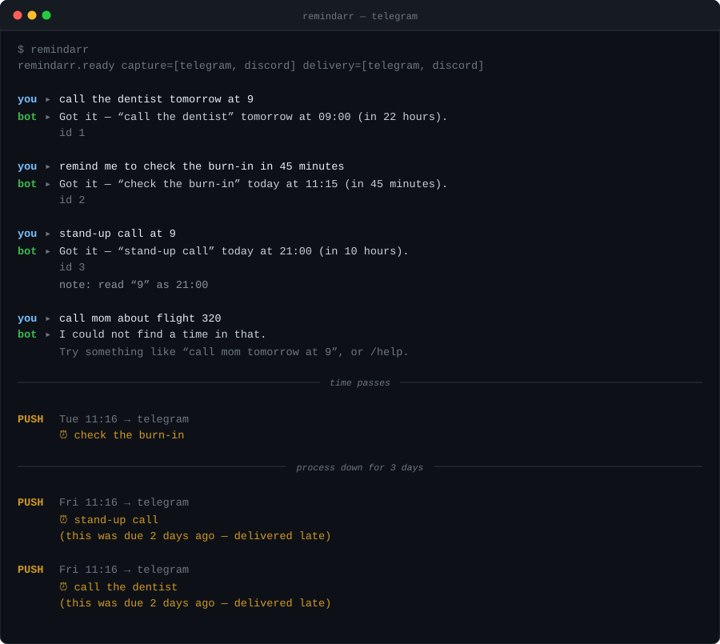
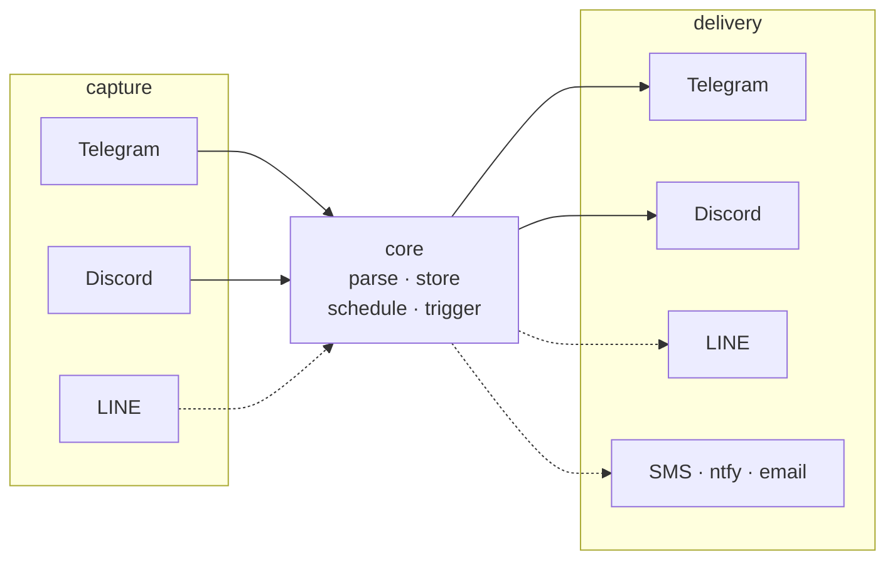

<h1 align="center">remindarr</h1>

<p align="center">
  <b>Self-hosted, chat-native reminders.</b><br>
  Tell a bot what to remind you about, in the chat app you already have open.<br>
  It tells you back, on time.
</p>

<p align="center">
  <a href="https://github.com/koseozgur/remindarr/actions/workflows/ci.yml"></a>
  
  
  <a href="https://github.com/astral-sh/ruff"></a>
  
  <a href="LICENSE"></a>
</p>

<p align="center">
  
</p>

<p align="center"><sub>Generated from the real code — see <a href="#how-it-works">How it works</a>.</sub></p>

**Status: v0, working end to end.** Telegram and Discord, one-shot reminders,
SQLite. See [Roadmap](#roadmap) for what is deliberately not here yet.

---

## Why this exists

Reminders are a solved problem — unless you want them self-hosted, in your
chat apps, and not tied to a vendor. The existing options each fail one of
those:

- **Home Assistant** works, but means running a whole home-automation platform
  to get reminders, and the usual capture path stores a full Amazon account
  password rather than a scoped token.
- **Todoist et al.** are hosted, and want to be your project manager.
- **The Telegram reminder bots** are mostly one-way, one-platform, and someone
  else's server.

## One thing, done right

Reminders. Not tasks, not notes, not a calendar, not habits. The scope
discipline *is* the product.

---

## The architecture bet

**Capture and delivery are separate problems, and most tools only solve one.**



<sub>Solid = shipped. Dashed = planned.</sub>

They are two protocols, not one, because their constraints genuinely differ.
A one-way SMS gateway is delivery-only and that is a first-class case, not a
degraded one. On LINE, *replying* to someone who messaged you is free while
*pushing* to them is quota-metered — so scheduled reminders are the expensive
direction and conversation is the cheap one. An architecture that assumed
symmetry would have to be unpicked to express that.

The core never sees a platform object. Adapters translate to
`IncomingMessage` / `OutgoingMessage` at the boundary.

### No inbound ports

Telegram long-polls and Discord uses its gateway websocket. Both are
**outbound** connections, so v0 runs behind NAT on a home NAS with no port
forwarding, no reverse proxy, and no TLS certificate.

That changes when LINE lands — LINE *requires* webhooks, and that is the point
at which ingress becomes a real deployment question. Worth knowing before you
plan for it.

---

## Quick start

Requires Python 3.13+. [`uv`](https://docs.astral.sh/uv/) recommended.

```bash
uv sync
cp .env.example .env    # then put your token(s) in it
uv run remindarr
```

A bot is enabled by having a token. There is no separate on/off flag to fall
out of sync with whether the credential is actually there.

### Getting a Telegram token

1. Message [@BotFather](https://t.me/BotFather), send `/newbot`, follow prompts.
2. Put the token in `.env` as `REMINDARR_TELEGRAM_TOKEN`.
3. Message your new bot. That is it.

### Getting a Discord token

1. [Developer Portal](https://discord.com/developers/applications) → New
   Application → Bot → Reset Token.
2. **Bot → Privileged Gateway Intents → enable MESSAGE CONTENT INTENT.**
   Without it the bot connects normally and then sees every message as blank,
   which looks exactly like a bug in this code. It is self-serve under 100
   servers. remindarr logs a specific warning if it detects this.
3. OAuth2 → URL Generator → scopes `bot`, permissions *Send Messages* +
   *Read Message History* → open the URL to invite it.
4. Put the token in `.env` as `REMINDARR_DISCORD_TOKEN`.

### Docker

```bash
mkdir -p data && chown 1000:1000 data
docker compose up -d
```

The SQLite database lives in `./data`, bind-mounted, so a container rebuild
does not take your reminders with it.

The container runs as uid 1000 rather than root, so the bind-mounted `./data`
has to be writable by that uid — hence the `chown`. On a Synology the share
may be owned by something else; `chown` it to 1000 or add
`user: "<uid>:<gid>"` to the compose service. Skipping this gives an opaque
`unable to open database file` at startup.

There is no `ports:` section, deliberately — both adapters connect outbound.

---

## Using it

Just say it:

```
call the dentist tomorrow at 9
remind me to check the burn-in in 45 minutes
water the plants on saturday morning
rent is due on 1 september
deploy freeze 2026-09-03 14:00
```

Commands:

| | |
|---|---|
| `/list` | what is pending |
| `/cancel <id>` | drop one |
| `/tz <zone>` | set your timezone, IANA name (`/tz Asia/Tokyo`) |
| `/help` | the above |

### What the parser accepts

Deliberately a **narrow, explicit grammar** rather than a general
natural-language date parser. A fuzzy parser's failure mode is silently reading
part of your task as a date — "call Mars about Q3" becoming March — which
produces a confidently wrong reminder. A narrow grammar's failure mode is
saying "I could not find a time in that", which you can immediately fix. For a
tool whose whole job is firing at the right moment, the second failure is much
cheaper.

```
in 20 minutes / in 20m / in 1h30m / in an hour / in 3 days / in 2 weeks
tomorrow / tomorrow at 9 / tomorrow at 09:30 / tomorrow morning
today at 18:00 / tonight / this evening / noon / midnight
at 9am / at 18:00 / at 9
monday / on monday at 9am / next friday
sep 3 / on 3 september at 10:00 / 2026-09-03 / 2026-09-03 14:00
```

Two ambiguities are resolved by *disclosure* rather than by guessing well:

- **`at 9`** with no am/pm resolves to whichever reading comes soonest — at
  15:00 that means 21:00 today; at 22:00 it means 09:00 tomorrow.
- **`next friday`** is treated as the soonest Friday. English does not agree
  with itself here, so remindarr says which date it picked.

Every confirmation echoes the resolved absolute time, so a wrong guess is
visible immediately rather than at the moment the reminder does not fire.

### Late delivery is stated, not hidden

If the process was down when a reminder came due, it fires on the next tick and
*says* it is late. Silently delivering a two-hour-old reminder as though it
were on time leaves you unable to tell whether you misread the clock or the
system failed you.

---

## Configuration

All via environment or `.env`, prefix `REMINDARR_`:

| Variable | Default | Meaning |
|---|---|---|
| `REMINDARR_TELEGRAM_TOKEN` | — | enables Telegram |
| `REMINDARR_DISCORD_TOKEN` | — | enables Discord |
| `REMINDARR_DATABASE_URL` | `sqlite+aiosqlite:///data/remindarr.db` | store |
| `REMINDARR_DEFAULT_TIMEZONE` | `Asia/Tokyo` | for subscribers not yet seen |
| `REMINDARR_TICK_SECONDS` | `15` | scheduler poll interval |
| `REMINDARR_MAX_DELIVERY_ATTEMPTS` | `5` | before giving up |
| `REMINDARR_RETRY_BACKOFF_SECONDS` | `30` | base for exponential backoff |
| `REMINDARR_LATE_DELIVERY_GRACE_MINUTES` | `60` | lateness before saying so |
| `REMINDARR_LOG_LEVEL` | `INFO` | |
| `REMINDARR_LOG_JSON` | `false` | JSON logs for shipping |

---

## How it works

The `reminders` table is the single source of truth. A loop polls it every
`tick_seconds` for anything due:

```sql
SELECT * FROM reminders WHERE state='pending' AND next_attempt_at <= now
```

No job-store library, no timer wheel. That buys restart safety (nothing to
resync), downtime catch-up (the query is `<=`, not `==`), and debuggability —
"why did this not fire?" is one query against a table a human can read. The
cost is up to `tick_seconds` of latency, which for reminders is noise.

`due_at` records intent and never changes. `next_attempt_at` moves on retry.
Keeping them separate means a reminder that took four attempts still knows when
it was *supposed* to arrive, which is what the lateness notice is computed from.

### Development

```bash
uv run pytest
uv run ruff check . && uv run ruff format --check .
uv run mypy
uv run python scripts/gen_demo.py   # regenerate the README's demo image
```

The demo image at the top is generated by driving the real `Router` and
`Scheduler` over a real database, so it cannot drift away from what the code
actually does.

No Alembic yet. The schema is young enough that a bad migration costs more than
a rebuild. When it stabilises and there is data worth preserving, that is the
moment to add migrations — not before.

---

## Roadmap

**Next up**

- **LINE.** The real differentiator — dominant in Japan, skipped by most
  Western self-hosted tools. Brings the first webhook requirement and a quota
  model where push is metered and reply is not.
- **Recurring reminders.** The schema has a reserved `recurrence` column; v0
  writes `NULL` and never reads it.

**The one worth protecting**

- **Location triggers.** Fire when you *arrive* somewhere with open items —
  rate-limited, not nagging. This is the thing a calendar structurally cannot
  do, and the real reason to pick this over the reminders app already on your
  phone. It is not a nice-to-have; it is the point.

**Later**

- Native mobile app, deliberately simple, retro-leaning.
- Slack, ntfy, email, SMS delivery adapters.
- Cross-platform identity linking (capture on Telegram, deliver to Discord).
  The data model already separates the two; what is missing is the UX for
  proving both accounts are you.

### WhatsApp: outbound only, and not soon

This is a deliberate scope decision, not an oversight. Meta deprecated the
on-premise/self-hosted API entirely — Cloud API is the only supported path for
new integrations — and it is built and priced for business use. Unofficial
workarounds exist and are exactly the TOS-gray path this project avoids. If
WhatsApp appears at all it will be delivery-only.

## Non-goals

- Not a project manager, note app, calendar, or habit tracker.
- No unofficial or TOS-gray platform integrations.
- Not chasing feature parity with Todoist.

## License

MIT
