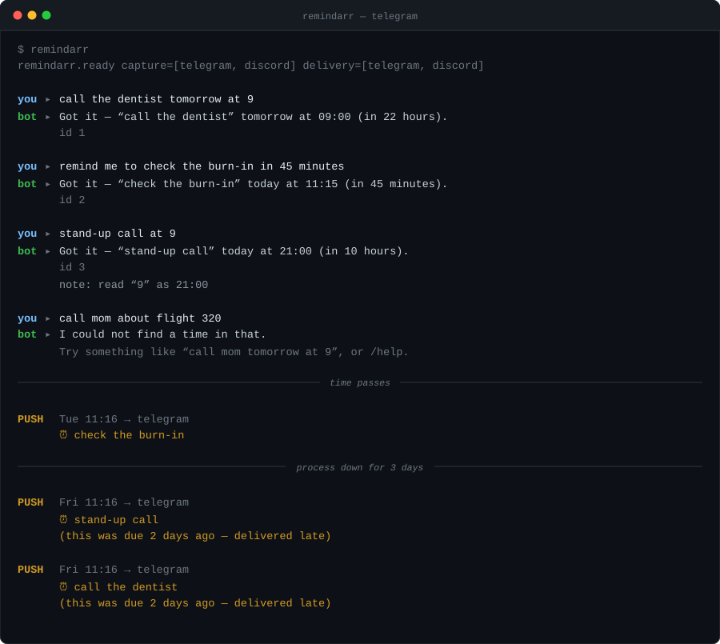
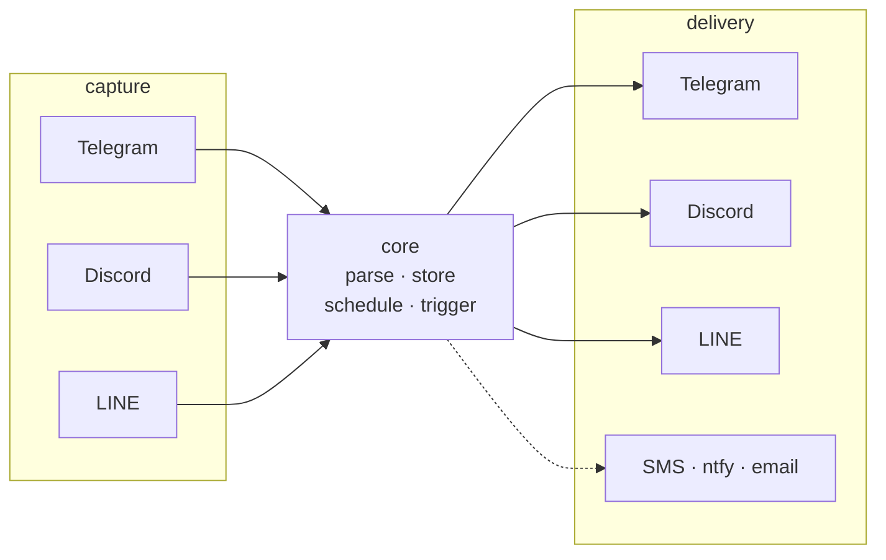

<h1 align="center">remindarr</h1>

<p align="center">
  <b>Self-hosted, chat-native reminders.</b><br>
  Tell a bot what to remind you about, in the chat app you already have open.<br>
  It tells you back, on time.
</p>

<p align="center">
  <a href="https://github.com/koseozgur/remindarr/actions/workflows/ci.yml"></a>
  
  
  <a href="https://github.com/astral-sh/ruff"></a>
  
  <a href="LICENSE"></a>
</p>

<p align="center">
  
</p>

<p align="center"><sub>Generated from the real code — see <a href="#how-it-works">How it works</a>.</sub></p>

**Status: v0, in daily use.** One-shot reminders on LINE, Discord and
Telegram, SQLite, invite-only access managed in chat, and cross-app delivery
(set it on LINE, get it on Discord). **LINE and Discord were verified live on 2026-11-08**, including
the allow-list's refusal path. **Telegram is implemented and tested but has
never made a real round trip.** See [Roadmap](#roadmap) for what is
deliberately not here yet.

---

## Why this exists

Reminders are a solved problem — unless you want them self-hosted, in your
chat apps, and not tied to a vendor. The existing options each fail one of
those:

- **Home Assistant** works, but means running a whole home-automation platform
  to get reminders, and the usual capture path stores a full Amazon account
  password rather than a scoped token.
- **Todoist et al.** are hosted, and want to be your project manager.
- **The Telegram reminder bots** are mostly one-way, one-platform, and someone
  else's server.

## One thing, done right

Reminders. Not tasks, not notes, not a calendar, not habits. The scope
discipline *is* the product.

---

## The architecture bet

**Capture and delivery are separate problems, and most tools only solve one.**



<sub>Solid = shipped. Dashed = planned.</sub>

They are two protocols, not one, because their constraints genuinely differ.
A one-way SMS gateway is delivery-only and that is a first-class case, not a
degraded one. On LINE, *replying* to someone who messaged you is free while
*pushing* to them is quota-metered — so scheduled reminders are the expensive
direction and conversation is the cheap one. An architecture that assumed
symmetry would have to be unpicked to express that.

The core never sees a platform object. Adapters translate to
`IncomingMessage` / `OutgoingMessage` at the boundary.

The bet pays off concretely: because a reminder records where to deliver
separately from where it was set, it can be captured on one app and delivered
on another. Capture on LINE, where replies are free; deliver on Discord, where
pushes are unlimited. See [Cross-app delivery](#cross-app-delivery).

### Inbound ports: none, unless you enable LINE

Telegram long-polls and Discord uses its gateway websocket. Both are
**outbound** connections, so with only those two enabled remindarr runs behind
NAT on a home NAS with no port forwarding, no reverse proxy, and no TLS
certificate.

LINE is different: it *requires* a webhook, so enabling it opens the project's
first inbound endpoint. remindarr listens on plain HTTP at
`REMINDARR_WEBHOOK_HOST:REMINDARR_WEBHOOK_PORT` (default `0.0.0.0:8080`), path
`REMINDARR_LINE_WEBHOOK_PATH`; LINE must reach that over **public HTTPS**. How
— a reverse proxy, a tunnel, a small VM — is a deployment choice remindarr does
not make for you.

LINE does not publish the addresses its webhooks come from, so requests are
authenticated solely by the `x-line-signature` HMAC, verified over the raw
body before anything is parsed. A request that fails it gets a 401 and touches
nothing.

---

## Quick start

Requires Python 3.13+. [`uv`](https://docs.astral.sh/uv/) recommended.

```bash
uv sync
cp .env.example .env    # then put your token(s) in it
uv run remindarr
```

A bot is enabled by having a token. There is no separate on/off flag to fall
out of sync with whether the credential is actually there.

**The first reply you get will be a refusal.** Nobody may use the bot until
they're in, and that includes you. Message the bot once; the refusal ends with
your id, like `(For the owner: telegram:123456789)`. Put that in `.env` as
`REMINDARR_ADMINS`, restart, and you're in as the admin. Everyone after you
joins with an invite from chat, with no more config. See
[People and access](#people-and-access).

### Getting a Telegram token

1. Message [@BotFather](https://t.me/BotFather), send `/newbot`, follow prompts.
2. Put the token in `.env` as `REMINDARR_TELEGRAM_TOKEN`.
3. Message your new bot. That is it.

### Getting a Discord token

1. [Developer Portal](https://discord.com/developers/applications) → New
   Application → Bot → Reset Token.
2. **Bot → Privileged Gateway Intents → enable MESSAGE CONTENT INTENT.**
   Without it the bot connects normally and then sees every message as blank,
   which looks exactly like a bug in this code. It is self-serve under 100
   servers. remindarr logs a specific warning if it detects this.
3. OAuth2 → URL Generator → scopes `bot`, permissions *Send Messages* +
   *Read Message History* → open the URL to invite it.
4. Put the token in `.env` as `REMINDARR_DISCORD_TOKEN`.

### Setting up LINE

LINE needs two credentials and a public HTTPS URL (see
[Inbound ports](#inbound-ports-none-unless-you-enable-line)).

1. Create a free **LINE Official Account**:
   [register a Business ID](https://account.line.biz/signup?redirectUri=https://entry.line.biz/form/entry/unverified)
   (your normal LINE account works), then fill in the
   [entry form](https://entry.line.biz/form/entry/unverified). The Developers
   Console can no longer create Messaging API channels itself (since 2024).
2. In the [Official Account Manager](https://manager.line.biz/), **enable the
   Messaging API**. You'll pick a provider, which can't be changed later. This
   creates the Messaging API channel in the
   [Developers Console](https://developers.line.biz/console/).
3. Developers Console → your channel:
   - **Basic settings** → *Channel secret* → `REMINDARR_LINE_CHANNEL_SECRET`.
   - **Messaging API** → *Channel access token (long-lived)* → Issue →
     `REMINDARR_LINE_CHANNEL_ACCESS_TOKEN`.

   Both are required. Setting only one is a startup error, not a silently
   disabled platform.
4. Turn **OFF** *Greeting messages* and *Auto-reply messages*: Developers
   Console → Messaging API tab → *Edit* next to each, which opens the Official
   Account Manager. Otherwise LINE answers alongside remindarr and every
   message gets two replies.
5. Start remindarr and make `…:8080/line/webhook` reachable over HTTPS.
6. Developers Console → Messaging API → *Webhook URL*: set it to your public
   URL, e.g. `https://example.com/line/webhook`, and press **Verify**. LINE
   sends an empty, signed test request; remindarr answers 200. Then turn on
   **Use webhook** on the same tab.
7. **Add the bot as a friend** (scan the QR code on the Messaging API tab),
   then message it. Pushes only reach people who have friended the account.

#### The quota, and what it costs you

On the free plan in Japan, LINE allows **200 counted messages a month**, as a
hard cap with no pay-as-you-go. What counts:

- **Scheduled reminders count** — each is a *push*. A reminder delivered to a
  group counts once per member: one reminder to a group of five is five. Only
  allowed users can set reminders, but an allowed user's group reminders are
  still billed per member — access control doesn't change that.
- **Replies are free** — confirmations, `/list`, `/help` and error messages go
  back on LINE's reply path, which is not metered. remindarr never retries a
  failed reply as a push.

When the month's quota runs out, LINE refuses pushes, and remindarr marks the
affected reminders failed (with "LINE monthly message limit reached") rather
than retrying into a wall. There is no warning before that point yet.

The way around the cap is not to push on LINE at all: set reminders on LINE
and have them [delivered on Discord](#cross-app-delivery). Every LINE message
is then a free reply.

#### Things LINE does not tell you

- **A user who blocked the account is undetectable.** LINE answers a push to
  them with 200 as though it were delivered. remindarr cannot tell, so neither
  can you.
- **Group messages from some clients have no user id.** LINE omits it for
  users not on LINE for iOS/Android. remindarr cannot tell who owns such a
  reminder, so it replies saying so instead of setting one.
- **Webhook redelivery is off by default.** If you turn it on, remindarr
  ignores duplicate events — but it remembers them in memory, so a redelivery
  arriving after a restart is processed again.

### Docker

```bash
mkdir -p data && chown 1000:1000 data
docker compose up -d
```

The SQLite database lives in `./data`, bind-mounted, so a container rebuild
does not take your reminders with it.

The container runs as uid 1000 rather than root, so the bind-mounted `./data`
has to be writable by that uid — hence the `chown`. On a Synology the share
may be owned by something else; `chown` it to 1000 or add
`user: "<uid>:<gid>"` to the compose service. Skipping this gives an opaque
`unable to open database file` at startup.

There is no published port by default, deliberately — Telegram and Discord
connect outbound. If you enable LINE, the container listens on 8080; uncomment
the `ports:` example in `docker-compose.yml` or put your ingress on the same
Docker network. How LINE reaches it is up to you.

One worked example: [`docs/deploy-gcp.md`](docs/deploy-gcp.md) runs it on a
free-tier GCP `e2-micro` behind Caddy (automatic HTTPS, only the webhook path
forwarded), with the cost model, updates, backups and teardown.

### People and access

remindarr answers only the people who are in. **It denies by default:** a
fresh install refuses everyone, and logs `access.allow_list_empty` at startup
so it doesn't look broken.

This matters most on LINE, where a bot's Basic ID is searchable: anyone can
friend it, and every reminder a stranger set would spend your monthly push
quota. On Telegram and Discord the cost is a stranger's data in your database.

**You, the first admin.** Message the bot once. The refusal ends with your id
in the exact format to paste:

```
Not authorised. If you have an invite, send /join followed by the code.
(For the owner: line:U4af4980629...)
```

Put it in `.env` and restart:

```bash
REMINDARR_ADMINS=line:U4af4980629...
```

An admin entry that belongs to nobody yet becomes a new user called `owner`.
Entries can also be names of existing users (`REMINDARR_ADMINS=owner`). It's
applied at every start and only ever grants admin.

**Everyone else: invites, in chat.** No config edits, no restarts:

```
you:  /invite mum
bot:  Ask mum to send me this on Discord or LINE within 24 hours:
      /join E96M-QVZS
mum:  /join E96M-QVZS
bot:  Welcome, mum! You're in.
```

**Your other apps: `/link`.** Send `/link` on one app and it gives you a
code. Send `/link CODE` from the other app within 10 minutes, and both are
you. That's also how remindarr knows it's really you on both: you just proved
it from each side.

**Admin commands:** `/users` lists who's in, and `/remove <name>` takes
someone out. Removing someone unlinks their apps and cancels their pending
reminders, including ones others set for them. You can't remove yourself.

**The codes.** Each is 8 characters, shown as `XXXX-XXXX`, with no
look-alike letters. Lowercase, a missing hyphen, or `o` for `0` and `l` for
`1` still work. Invites last 24 hours and link codes 10 minutes. Each works
once, and only a hash is stored. Five wrong codes from one account, or fifty
overall, block code entry for an hour. A wrong, expired and used code all get
the same answer, so a guess learns nothing.

- In a group, the check is on the **person who sent the message**, not the
  group. An allowed user can set reminders in a group with strangers in it.
  The strangers cannot, and get the same refusal. A LINE group message with no
  user id ([see above](#things-line-does-not-tell-you)) is always refused.
- A refused user gets no subscriber row, no reminder, and no command, not
  even `/help`. The one thing a stranger can do is redeem a code.

**Upgrading from the env-file allow-list.** On the first start with no users
in the database, `REMINDARR_ALLOWED_USERS` and `REMINDARR_PEOPLE` are imported
once, so an existing install keeps working. After that the database is the
source of truth, and editing those two changes nothing. An allow-list entry
that isn't in a person is imported as a user named after it
(`telegram-123456`), credited by their chat display name, and can't be
`@`-named.

### Cross-app delivery

By default a reminder arrives where you set it. To set reminders on one app
and get them on another, [link](#people-and-access) both apps to you with
`/link`, then pick where you want them:

```
/deliver discord
```

Now a reminder set in your one-to-one LINE chat arrives as a Discord DM, and
the confirmation says so:

```
Got it — “take the bins out” tomorrow at 09:00 (in 14 hours).
id 7
It'll arrive as a direct message on Discord.
```

**Why you would want this:** on LINE's free plan, replies are free and pushes
are capped at 200 a month ([details](#the-quota-and-what-it-costs-you)). If
you capture on LINE and deliver on Discord, every LINE message is a free
reply, and the cap stops mattering.

`/deliver` on its own shows the current choice, and `/deliver here` goes back
to "wherever I set it". You can only pick an app you've linked and that is
running here; anything else is refused, saying why.

**The default applies to one-to-one chats only.** A reminder set in a LINE or
Telegram group goes back to that group. A group reminder is for the group.

**Discord is the exception: reminders always arrive by DM.** A reminder set in
a server channel goes to the setter's DMs, and the reply in the channel says
*I'll DM you when it's due.* If the DM is refused (the bot shares no server
with you, or your DMs from server members are off), it is delivered to the
channel it was set in instead, with a mention of you so you are still
notified. If that fails too, the reminder is marked failed and says why.

**Per reminder: `@app`.** Put `@discord`, `@line` or `@telegram` anywhere in
the message to have that one reminder delivered to you directly on that app.
That includes from a group, and it overrides your default:

```
call mum tomorrow at 9 @line
```

The `@` is deliberate. "post the update on discord tomorrow" is a real task,
and remindarr will never read plain words as routing. That is the same rule
the time parser follows: never silently eat part of the task. So:

- only `@line`, `@discord` and `@telegram` are acted on; any other `@word`
  (`email @john about the invoice tomorrow`) stays in the reminder as written;
- for the same reason, nobody can be named after an app;
- two apps in one message, an app you have no linked identity on, or an app
  that is not enabled are all refused, saying why.

`/list` marks reminders that will arrive somewhere other than the current chat
(`#7 take the bins out — tomorrow at 09:00 (in 14 hours) → Discord DM`).

Delivering on Discord to someone who has not written from Discord opens a DM
with them. That needs the bot to share a server with them and their DMs from
server members to be on. A cross-app reminder has no channel to fall back
to, so if the DM is refused it fails permanently, with a message saying so,
and is not retried.

**Nothing in a reminder can ping anyone.** Reminder text is whatever someone
typed. On Discord every message is sent with mentions disabled, so
`@everyone`, `@here`, a role or a user mention in the text is inert. The one
exception is the channel fallback's mention of the person the reminder is for.

One limit: each app's identity still has its own reminders. `/list` and
`/cancel` on Discord don't see what you set on LINE.

### Reminding someone else

Name someone who's in with `@`:

```
take out the bins @mum tomorrow at 21:00
```

The reminder goes to mum, and you are told where it will go:

```
Got it — “take out the bins” tomorrow at 21:00 (in 11 hours).
id 12
It'll go to mum as a direct message on LINE, marked “from oz”.
```

At 21:00 mum gets `⏰ take out the bins (from oz)`. The "from" is your
user name, or your chat display name if you were imported without one.

- **Which app:** add `@line` or `@discord` to choose (`@mum @line`).
  Otherwise it goes to mum's default app if she has one, or to her only app.
  If she has several and no default, remindarr asks you to pick rather than
  guess. A person with no identity on the app you asked for is refused.
- **On Discord**, a real mention (`@mum` picked from the member list, which
  Discord sends as `<@id>`) works too, if that account is linked to a user.
  A name or mention that isn't a user stays in the text as written.
- **It is yours.** It is parsed in your timezone. It shows in your `/list`
  (`#12 take out the bins — … → mum on LINE`), and only you can `/cancel` it.
  Mum does not see it until it arrives.
- **One person per reminder.** Naming two people is refused; set one each.
  Naming yourself is just a normal reminder.
- **Discord fallback.** If mum's Discord DMs are closed and you set it in a
  server channel, it falls back to that channel, mentioning mum and no one
  else.
- **Who may remind whom:** anyone who's in may remind anyone else who's in.
  There is no consent step. This is meant for a trusted household, where the
  admin already decided who's invited.
- **Quota:** a reminder delivered to someone by LINE push counts against the
  200/month cap exactly as your own would.

---

## Using it

Just say it:

```
call the dentist tomorrow at 9
remind me to check the burn-in in 45 minutes
water the plants on saturday morning
rent is due on 1 september
deploy freeze 2026-09-03 14:00
take the bins out every monday at 7pm
```

Commands:

| | |
|---|---|
| `/list` | what is pending, as `#id text — when`; repeats are marked 🔁 |
| `/cancel <id>` | drop one (`/cancel 3` or `/cancel #3`); for a repeat, the whole series |
| `/tz <zone>` | set your timezone, IANA name (`/tz Asia/Tokyo`) |
| `/help` | the above |

Add `@line`, `@discord` or `@telegram` to a reminder to have it delivered on
that app; see [Cross-app delivery](#cross-app-delivery).

### What the parser accepts

Deliberately a **narrow, explicit grammar** rather than a general
natural-language date parser. A fuzzy parser's failure mode is silently reading
part of your task as a date — "call Mars about Q3" becoming March — which
produces a confidently wrong reminder. A narrow grammar's failure mode is
saying "I could not find a time in that", which you can immediately fix. For a
tool whose whole job is firing at the right moment, the second failure is much
cheaper.

```
in 20 minutes / in 20m / in 1h30m / in an hour / in 3 days / in 2 weeks
tomorrow / tomorrow at 9 / tomorrow at 09:30 / tomorrow morning
today at 18:00 / tonight / this evening / noon / midnight
at 9am / at 18:00 / at 9
monday / on monday at 9am / next friday
sep 3 / on 3 september at 10:00 / 2026-09-03 / 2026-09-03 14:00
```

Two ambiguities are resolved by *disclosure* rather than by guessing well:

- **`at 9`** with no am/pm resolves to whichever reading comes soonest — at
  15:00 that means 21:00 today; at 22:00 it means 09:00 tomorrow.
- **`next friday`** is treated as the soonest Friday. English does not agree
  with itself here, so remindarr says which date it picked.

Every confirmation echoes the resolved absolute time, so a wrong guess is
visible immediately rather than at the moment the reminder does not fire.

### Recurring reminders

Say `every`. The same narrow-grammar rule applies: a short list of forms, and
anything outside it gets **"I can't repeat that yet"** with examples, never a
guess.

```
every day at 9 / every 3 days / every other day / every morning
every weekday at 8:00 / every weekend at 10
every monday at 7pm / every mon and thu at 18:00 / every mon, wed and fri
every week on friday / every 2 weeks on friday / every other week on thu at 7am
every month on the 25th / every month on the 1st / every 3 months on the 2nd
every year on 3 sep / every year on sep 3rd at 8pm
every hour / every 2 hours
```

The repeat can sit at the end (`take pills every day at 9`) or the start
(`every monday at 9 call mom`), and a time may come before it
(`call mom at 7pm every day`). A head time may end with `,` `:` or a dash
(`every monday at 7pm: bins out`), as can a one-off's (`tomorrow at 9, call
mom`). The confirmation states the pattern and the next
occurrence in absolute terms:

```
Got it — “standup” every weekday at 08:00, next: Wed 19 Aug 08:00 (in 21 hours).
```

How it behaves:

- **Times are read as written.** A repeat always names its days, so `at 9` is
  09:00 — like `tomorrow at 9`, and unlike a bare `at 9`, which picks the
  soonest reading. A series' time must not depend on the moment it was set.
  Without am/pm the confirmation says how `9` was read. With no time at all,
  09:00; `every morning` / `afternoon` / `evening` / `night` mean 09:00 / 14:00
  / 19:00 / 20:00.
- **Day-level repeats start at the soonest match.** `every 2 weeks on friday`
  said on a Saturday starts the coming Friday, then every second Friday from
  there.
- **Month ends:** `every month on the 31st` falls on the *last day* of shorter
  months (30 Sep, 28 Feb). For a reminder ("pay rent") that beats the RFC 5545
  default of skipping those months. `every year on 29 feb` is 28 Feb in other
  years.
- **Wall-clock time holds across DST.** `every day at 08:00` stays at 08:00
  local when the offset changes. A time inside a spring-forward gap fires an
  hour later on the wall clock that day; a time in the repeated fall-back hour
  fires once. `every hour` is always 60 minutes apart in real time.
- **A series keeps the timezone it was set in.** A later `/tz` affects new
  reminders, not existing repeats.
- **Not supported, on purpose:** anything more often than hourly, end dates
  and exceptions (`until june`, `except weekends`, `for a week`), two times in
  one repeat (`at 8am and 8pm`, or a time left in the task text), `every 2
  weeks` with no day, nth weekdays (`every last friday`), and `daily` /
  `weekly` used as a repeat (`take pills daily at 8`; say `every day`).
  `daily standup tomorrow at 9` is still a one-off. All of these are refused,
  never guessed: with a repeat, a guess repeats forever.
- **`/list` after `/tz`** shows a series in its own zone and names it
  (`every day at 08:00 Asia/Tokyo time, next …`).

Scheduling: one row carries the whole series. After an occurrence is delivered
— or given up on after retries, or failed permanently — `due_at` moves to the
next occurrence after now, so a single failure never ends the series and
`/cancel` stops all of it. Each occurrence has its own `due_at`, and so its own
LINE retry key, while retries of one occurrence share theirs. If the process
was down across several occurrences, you get **one** catch-up, for the most
recent missed occurrence and marked late, then the series carries on from the
next future one. Never a burst. A delivered repeat says so:

```
⏰ take pills
(repeats every day at 21:00)
```

The rule is stored in the existing `recurrence` column as RFC 5545 text
(`DTSTART;TZID=…` + `RRULE:…`) and expanded with `dateutil.rrule`, so a
database built before this works unchanged.

### Late delivery is stated, not hidden

If the process was down when a reminder came due, it fires on the next tick and
*says* it is late. Silently delivering a two-hour-old reminder as though it
were on time leaves you unable to tell whether you misread the clock or the
system failed you.

---

## Configuration

All via environment or `.env`, prefix `REMINDARR_`:

| Variable | Default | Meaning |
|---|---|---|
| `REMINDARR_TELEGRAM_TOKEN` | — | enables Telegram |
| `REMINDARR_DISCORD_TOKEN` | — | enables Discord |
| `REMINDARR_ADMINS` | — | admins, as names or `platform:user_id`; an unknown identity becomes the first user ([details](#people-and-access)) |
| `REMINDARR_ALLOWED_USERS` | — | **seed only**: imported once into an empty database, then ignored ([details](#people-and-access)) |
| `REMINDARR_PEOPLE` | — | **seed only**, like the above: identities that are one person, `name = platform:id, … > app` |
| `REMINDARR_LINE_CHANNEL_SECRET` | — | with the token below, enables LINE |
| `REMINDARR_LINE_CHANNEL_ACCESS_TOKEN` | — | with the secret above, enables LINE |
| `REMINDARR_WEBHOOK_HOST` | `0.0.0.0` | webhook listen address (LINE only) |
| `REMINDARR_WEBHOOK_PORT` | `8080` | webhook listen port (LINE only) |
| `REMINDARR_LINE_WEBHOOK_PATH` | `/line/webhook` | webhook path LINE posts to |
| `REMINDARR_DATABASE_URL` | `sqlite+aiosqlite:///data/remindarr.db` | store |
| `REMINDARR_DEFAULT_TIMEZONE` | `Asia/Tokyo` | for subscribers not yet seen |
| `REMINDARR_TICK_SECONDS` | `15` | scheduler poll interval |
| `REMINDARR_MAX_DELIVERY_ATTEMPTS` | `5` | before giving up |
| `REMINDARR_RETRY_BACKOFF_SECONDS` | `30` | base for exponential backoff |
| `REMINDARR_LATE_DELIVERY_GRACE_MINUTES` | `60` | lateness before saying so |
| `REMINDARR_LOG_LEVEL` | `INFO` | |
| `REMINDARR_LOG_JSON` | `false` | JSON logs for shipping |

---

## How it works

The `reminders` table is the single source of truth. A loop polls it every
`tick_seconds` for anything due:

```sql
SELECT * FROM reminders WHERE state='pending' AND next_attempt_at <= now
```

No job-store library, no timer wheel. That buys restart safety (nothing to
resync), downtime catch-up (the query is `<=`, not `==`), and debuggability —
"why did this not fire?" is one query against a table a human can read. The
cost is up to `tick_seconds` of latency, which for reminders is noise.

`due_at` records intent and never changes. `next_attempt_at` moves on retry.
Keeping them separate means a reminder that took four attempts still knows when
it was *supposed* to arrive, which is what the lateness notice is computed from.

### Development

```bash
uv run pytest
uv run ruff check . && uv run ruff format --check .
uv run mypy
uv run python scripts/gen_demo.py   # regenerate the README's demo image
```

#### LINE webhook on a dev machine

LINE only talks to a public HTTPS URL. For development, `scripts/dev-tunnel.sh`
opens a [Cloudflare quick tunnel](https://developers.cloudflare.com/cloudflare-one/connections/connect-networks/do-more-with-tunnels/trycloudflare/)
(no Cloudflare account; `brew install cloudflared`) to the local webhook port
and prints the exact URL to paste into the LINE console:

```bash
scripts/dev-tunnel.sh
```

- **The URL is random and changes on every run.** Each time, paste it into
  Developers Console → Messaging API → *Webhook URL* again and press Verify.
- **While it runs, the webhook port is public.** Anyone who finds the URL can
  reach it; the `x-line-signature` check is the only gate. Stop it when you
  are done.
- `scripts/line_webhook_check.py <url>` (secret in
  `REMINDARR_LINE_CHANNEL_SECRET`) sends a signed and a wrongly signed Verify
  payload and checks for 200 / 401. Use it to test the tunnel without LINE.

This is for development only. Production ingress is a separate, undecided
question.

The demo image at the top is generated by driving the real `Router` and
`Scheduler` over a real database, so it cannot drift away from what the code
actually does.

No Alembic yet. The schema is young enough that a bad migration costs more than
a rebuild. When a version adds a column (cross-app delivery added
`reminders.fallback_address`; reminding others added `reminders.recipient`),
an older database is refused at startup with a
message naming the missing column. Back it up if it matters, then delete it
and start fresh. When it stabilises and there is data worth preserving, that is the
moment to add migrations — not before.

---

## Roadmap

**Next up**

- **A warning before LINE's monthly push quota runs out**, for anyone who
  still delivers on LINE.

**The one worth protecting**

- **Location triggers.** Fire when you *arrive* somewhere with open items —
  rate-limited, not nagging. This is the thing a calendar structurally cannot
  do, and the real reason to pick this over the reminders app already on your
  phone. It is not a nice-to-have; it is the point.

**Later**

- Native mobile app, deliberately simple, retro-leaning.
- Slack, ntfy, email, SMS delivery adapters.
- One `/list` across a person's identities, so you can see and cancel on
  Discord what you set on LINE.
- Reminding several people at once; letting a recipient see (or cancel) what
  others set for them; parsing a reminder for someone in *their* timezone.

### WhatsApp: outbound only, and not soon

This is a deliberate scope decision, not an oversight. Meta deprecated the
on-premise/self-hosted API entirely — Cloud API is the only supported path for
new integrations — and it is built and priced for business use. Unofficial
workarounds exist and are exactly the TOS-gray path this project avoids. If
WhatsApp appears at all it will be delivery-only.

## Non-goals

- Not a project manager, note app, calendar, or habit tracker.
- No unofficial or TOS-gray platform integrations.
- Not chasing feature parity with Todoist.

## License

MIT
